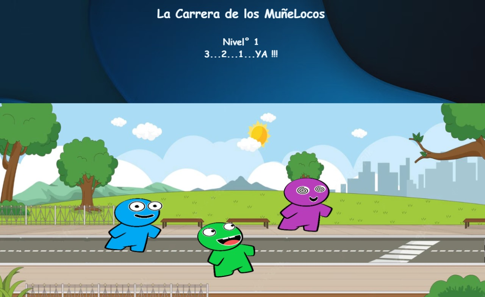

### 🏃‍♂️ La Carrera de los Muñelocos

[Jugar Ahora](https://sebaromerox.github.io/carrera-munelocos)
[Código Fuente](https://github.com/SebaRomeroX/carrera-munelocos)

### 🎮 ¿Cómo Jugar?

**¡Presiona izquierda-derecha lo más rápido que puedas y corre contra los bots!** Un juego divertido y adictivo creado con JavaScript puro.

1. **Elige tu personaje** entre 5 opciones diferentes
2. **Presiona alternadamente** las teclas ← y → (botones en móvil)
3. **¡Corre más rápido que los bots!** Gana para avanzar al siguiente nivel
4. **Los bots aceleran** con cada nivel. ¿Hasta dónde llegarás?

### 🖼️ Vista Previa

### 🛠️ Tecnologías Usadas

- **JavaScript Vanilla**
- **HTML5 Canvas** para gráficos y animaciones
- **CSS**
- **GitHub Pages** para deployment

### ✨ Características Principales

- ✅ **5 personajes seleccionables** con colores y caras únicas
- ✅ **Sistema de niveles infinitos** (los bots aceleran progresivamente)
- ✅ **Mecánica de movimiento**: paso izquierdo → paso derecho (no hay trampas)
- ✅ **Competencia contra IA** con dos bots oponentes
- ✅ **Juego sin fin** - desafía tus límites de velocidad

### 🎯 **Movimiento Realista del Personaje**

**Problema:** Necesitaba que el personaje alternara pies obligatoriamente (no dos pasos seguidos con el mismo pie).
**Solución:** Implementé un sistema de estados con dos imágenes diferentes (pie izquierdo/pie derecho) y validación de secuencia de teclas.

### 📱 Versión Móvil con Controles Táctiles

**Problema:** En móviles no hay teclado físico.  
**Solución:** Creé botones en pantalla que simulan las teclas ← y → con la misma lógica de alternancia.

### 🚀 Cómo Ejecutar Localmente

**Clona el repositorio:** git clone https://github.com/SebaRomeroX/carrera-munelocos  
Entra a la carpeta: cd carrera-munelocos  
Instala las dependencias: npm install  
Y arranca el servidor de desarrollo: npm run dev (abre la URL que muestra en tu navegador)

> El juego usa módulos ES nativos, así que no funciona abriendo index.html con doble clic (file://); necesitas un servidor como el de `npm run dev`

### 📈 Evolución del Proyecto

Este juego fue un proyecto de experimentación donde apliqué lo que había aprendido sobre Desarrollo Web

- **Refactorización gradual** mejor organización y legibilidad
- **Mejoras de UI/UX** estilos y controles móviles
- **Deployment** poder compartirlo

### 💡 Lo Que Aprendí / Reflexión

"Este proyecto fue un juego dentro de otro juego.
Me divertí experimentando y probando lo que iba haciendo,
puse en práctica lo aprendido pero aprendí muchísimo más mientras lo desarrollaba "

- La simplicidad en la mecánica puede crear diversión pura
- Refactorizar es parte natural del crecimiento como dev
- Mobile-first es crucial incluso en proyectos pequeños

### 🔧 ¿Qué Haría Diferente Hoy?

- Usaría **React** para una arquitectura más mantenible
- Implementaría **spritesheets** en lugar de imágenes separadas
- Añadiría sistema de **puntuación** y leaderboards
- Mejoraría la IA de los bots con **comportamientos más variados**
- Agregaría un modo **multijugador** local
- Efectos de **sonido y música**
- Diferentes **escenarios**

### 👨‍💻 Autor

Sebastian A. Romero - [Portfolio](https://sebaromerox.github.io/portafolios/)  
⭐ ¿Lo jugaste? Deja una estrella al repositorio si te divirtió!
